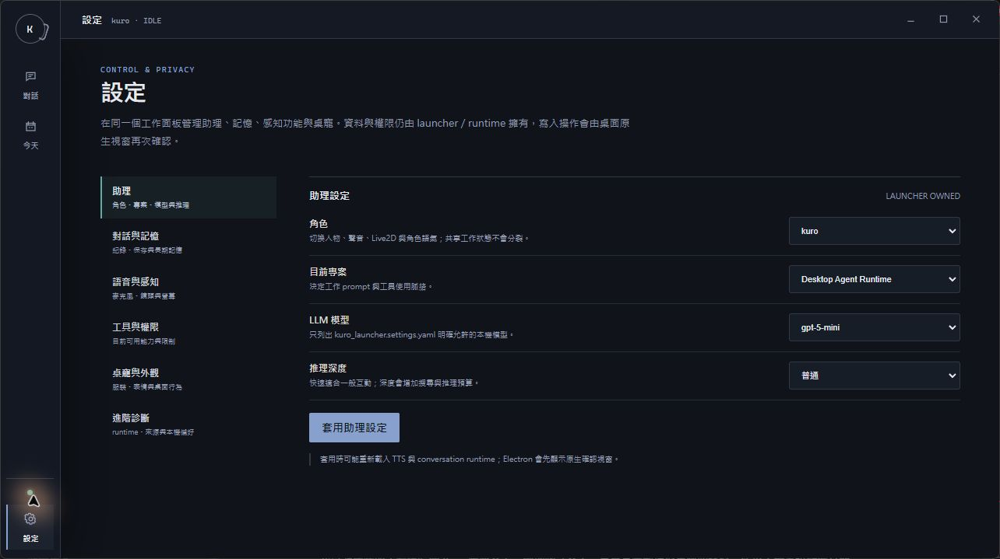
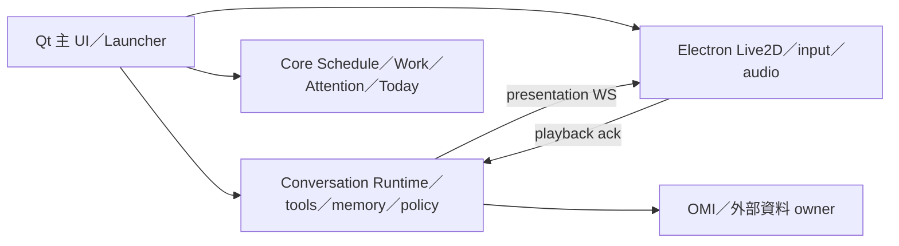

# Kuro

**Windows 上的 local-first 個人 AI 工作經理。**

Kuro 整合 Qt 主 UI、Live2D 桌寵、角色語音、受控工具與本機記憶，協助整理分散的工作資訊與下一步。角色與語音是互動介面；外部專案仍擁有自己的資料與專業判斷。

目前產品版本：**1.1.0**（以 [`VERSION`](VERSION) 為準）。為單一使用者的本機環境設計，目前不是一鍵安裝的通用產品。

*2026-08-24 實際 runtime 畫面，使用設定頁避開私人內容；舊 Electron UI 歷史紀錄，非目前 Qt 介面或版本驗收畫面。*

## 可以做什麼

| 需求 | 入口 |
| --- | --- |
| 對話、歷史與附件 | Qt Chat／History |
| 掃描當日來源狀態 | Qt Today／Schedule，保留來源限制 |
| 常駐短互動 | Live2D 桌寵、表情、動作與角色語音 |
| 使用外部工具與市場結果 | 受控工具；市場資料與判斷由 OMI 提供 |
| 管理角色與工作情境 | 設定、project packs 與記憶介面 |

長回答保留文字，spoken rendering 產生較短的角色語音。來源 stale、partial、missing 或失敗時，畫面與語音都必須保留限制。

*同日桌寵裁圖，未含桌面私人內容。更多入口見[功能導覽](docs/guides/feature-tour.md)。*

## 開始使用

本機環境已備妥時，執行根目錄 `桌寵啟動器.vbs`。Qt 主 UI 先顯示並管理服務；再次執行喚回同一 Qt，X 隱藏到 Qt tray；明確 Quit 才停止自有服務。

Qt 是唯一日常入口，包含 Chat、Today、Schedule、Settings、History、Memory 與 Diagnostics。Electron 只提供 Live2D／音效／presentation／pet-local control。Pet 不存在時仍可使用文字對話；中央語音由外部 owner 管理。詳見[故障排查](docs/guides/troubleshooting.md)。

第一次使用請讀[開始使用](docs/guides/getting-started.md)。Git 不包含 Python 環境、模型、私人語音或憑證；中央語音需獨立準備。`00_kuro_bootstrap.ps1` 與 `compose.yaml` 是舊實驗，不是完整安裝入口。

## 如何協作

Launcher 管啟動與診斷，Conversation Runtime 管對話、工具與記憶，Core 管 Schedule 與 Today。Electron 不讀 Mail／Study、不分類 Today、不建立 application UI 或 tray。設定、資料流與 API 見[現況架構](docs/architecture/RuntimeArchitecture.md)。

## 目前限制

- Qt 收斂的 G7 **35/35 legacy 檔案已實體刪除並獨立驗證**，正式產品仍未 ACCEPTED。本輪 Node 架構 20/20、MCP 18/18、語法與 Renderer typecheck 通過；完整 Python／Node 回歸及 Renderer build 因 Codex 的暫存目錄寫入權限限制無法在本輪驗證，需要在正常可寫環境重跑。先前 Electron 隱藏視窗 smoke 仍存在 renderer/GPU 啟動 FAIL，Qt／Live2D／Voice／OS 通知尚待使用者實機驗收。詳見 [G7 最終複查](docs/agent-runs/qt-ui-convergence-20261007/G7PostDeleteAcceptance-20261010.md)、[G8Checkpoint](docs/agent-runs/qt-ui-convergence-20261007/G8Checkpoint.md) 與[實機驗收](docs/agent-runs/qt-ui-convergence-20261007/G8ManualAcceptance.md)。

- Core Today 已接管來源投影；Mail／Study 是否可用取決於 enabled、handoff 與 freshness，目前預設 disabled，不能捏造待辦。
- Qt 特定操作有 native confirmation；一般工具 `confirm` 模式目前會拒絕執行，不是完整確認佇列。
- 寫入、刪除、發送、發布、長期記憶修改與高成本操作遵守工具政策，不能因 persona 或 prompt 繞過。
- 中央語音仍有人工聽感與桌面互動待驗收，見[語音文件](docs/central-voice-runtime.md)。
- 尚無已驗證的完整新機安裝、跨元件一鍵備份或 Kuro 整體 CI；source checks 不等於產品驗收。
- 第三方素材與 bundled dependencies 尚未完成整包分發授權稽核，不能把根目錄授權套用到所有資產。

## 文件

- [文件入口](docs/index.md)：使用、維護與文件缺口。
- [開始使用](docs/guides/getting-started.md) · [功能導覽](docs/guides/feature-tour.md) · [故障排查](docs/guides/troubleshooting.md)。
- [開發指南](docs/guides/development.md) · [架構索引](docs/architecture/index.md)。
- [產品願景](docs/product/ProductVision.md) · [運作模型](docs/product/OperatingModel.md) · [品質門檻](docs/product/QualityBar.md) · [Roadmap](docs/product/Roadmap.md)。

## 公開政策與授權

[貢獻指南](CONTRIBUTING.md) · [行為準則](CODE_OF_CONDUCT.md) · [安全政策](SECURITY.md)

Kuro 自有程式與文字文件採 [Apache License 2.0](LICENSE)。上游 Open-LLM-VTuber、Cubism、角色、字型與其他素材保留各自條款，見 [第三方聲明](THIRD_PARTY_NOTICES.md) 與 [NOTICE](NOTICE)。
