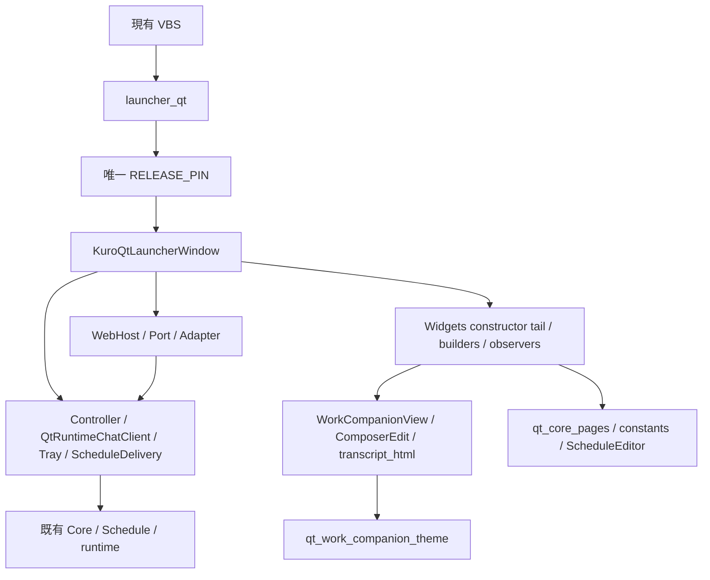

# Widgets 退役 owner 圖與條件式清單

2026-10-11。**目前刪除 allowlist 為空**。Widgets 是正式入口，不能稱為 dead code；以下是 W6.F 獲人工批准且正式 Web 顯示驗收後，才可使用的候選移除範圍。

機器圖：[WidgetsOwnerGraph.json](.runtime/w6e-review-20261011T140713669061Z/WidgetsOwnerGraph.json) 與 [OwnerObserverGraph.json](.runtime/w6e-review-20261011T140713669061Z/OwnerObserverGraph.json)。前者提供逐方法 self call/callback 正反向引用、source SHA、line/endLine、片段 preimage SHA 及限定 source/tests 的跨檔引用；後者列 63 bindings／41 Widget-reachable lexical paths。圖包含雙分支、dynamic getattr／Qt virtual callbacks 須人工複核，數量不是 Web runtime observers。

| 分類 | 精確範圍與處置 |
| --- | --- |
| 可條件退役的 presentation builders | qt_app 的 `_build_ui`、`_build_status_panels`、`_build_settings_surface`、`_build_chat_page`、`_build_workspace_page`、`_build_chat_memory_page`、`_build_chat_tab`、`_build_memory_tab`、`_build_pet_page`、`_build_settings_page`、`_build_perception_page`、`_build_tools_page`。12 個候選，每個需先處理圖中 reverseReferences；不可只刪 callee。 |
| 可條件整檔退役 | qt_work_companion_view.py、qt_work_companion_theme.py；先移除 qt_app imports、遷移 direct consumers/tests。不可刪原版六 renderer 或把舊 Widgets tests 當成 Web acceptance。 |
| 必須分開審核 | qt_app `__init__` 的 Widgets 尾段、Widget signal wiring、render/history/attachment callbacks、constants、APP_STYLE。只刪純 presentation；shared method 的 `_web_mode` guard 不能整個誤刪。 |
| 暫不列入整檔移除 | qt_core_pages.py：MAIN_NAV_KEYS／SETTINGS_LABELS、CorePage、TodayPage、SchedulePage、CoreHealthPage、ScheduleEditor 與 tests 存在直接引用。需逐 caller migration，再另審整檔是否無引用。 |
| Lifecycle 永久保留 owner | launcher_qt activation/mutex、Controller、QtRuntimeChatClient、QtScheduleDelivery、Qt tray、Core/Schedule runtime/store。cleanup、closeEvent、reveal、quit/restart、auto-connect、startup intent、task completion、stdout diagnostics 保留。 |
| Shared native modal | QMessageBox／QFileDialog／confirmation、WebHost.Port.confirm 及 restart confirm 不屬可一括移除的 Widgets legacy。單一 QMainWindow 仍需要 Qt Widgets 基礎設施。 |
| 已退役 G7 | 原 35 個檔案維持 absent；不得為測試、相容或 fallback 恢復。 |

未來最小順序：人審與採用 → 新 source/preimage checkpoint → 處理 constructor/observers/callers → 移除候選 builders → 遷移測試 → 再判整檔退役 → 重跑 source/isolated/native 與真正式顯示驗收。每階段若產生第二 client/controller、ghost observer、額外 poll/read 或動態引用不明，即停止，不用 fallback 遮掩。

## 回復檢查點

[ManualRollbackCheckpoint.json](.runtime/w6e-review-20261011T140713669061Z/ManualRollbackCheckpoint.json) 與同目錄 `manual-preimages/` 保存 release module、launcher、VBS、qt_app、view、theme、core-pages 七份現況 bytes。這些是現在的保全，不足以授權覆寫未來 WIP；每次正式改動前都要重新核對／補錄 exact preimages。

- 本輪只改 validation wrapper，preimage 在 `preimages/`，本輪新增工具／test／文件逐檔記於 Preservation；回復本輪須比對 current=postimage，只還原 allowlist bytes、另行審核新增檔。不得用 HEAD 覆蓋既有 WIP。
- 未來 pin 切換 rollback：先按 owner 正常退出，不廣泛 kill；核 current 等於已批准 postimage，僅還原 qt_web_release.py 的 None preimage，再由使用者確認以原入口啟動。VBS 不需變更。
- 未來刪 Widgets rollback：每一檔／片段先留可讀 preimage；依該階段精確清單還原 caller 和 callee。hash 不符、私人資料或未知 owner 一律停止。
- 不執行 reset／checkout／clean／stash，不以 Git HEAD 當 WIP identity，不回滾私人 DB、Memory、profile 或 shared Voice。

本輪未執行任何回復、切換、刪除、commit 或 push。
