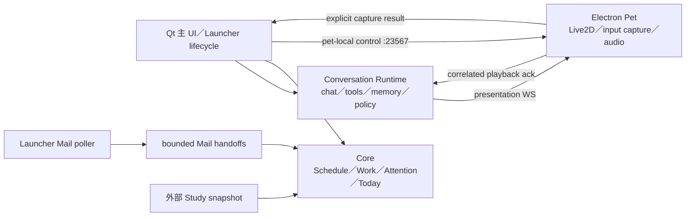

# Kuro 現況架構

2026-10-09 Qt final convergence source 狀態。**這不是正式桌面驗收通過聲明**；release blockers 與實測結果見 [G8Checkpoint](../agent-runs/qt-ui-convergence-20261007/G8Checkpoint.md)。

## 唯一責任鏈

- Qt 提供 Chat、Today、Schedule、Settings、History、Memory、Diagnostics；同時擁有 tray、native confirmation 與通知顯示。
- Conversation Runtime 擁有對話、history、tools、memory 與執行政策。Qt WS role 為 `qt-primary`；Pet role 為 `pet-presentation`，不能觸發對話、history/config/tool 操作或 interrupt。
- Core 的 `/v1/today` 為唯一 Today projection。來源的 missing/stale/disabled 不可被空集合或健康狀態取代；有設定與有可用資料是不同證據。
- Electron 只有一個 Pet BrowserWindow。任何 desktop-owner env 值都不會恢復舊 application UI；沒有 WorkPanel/Reader/Briefing、tray、Schedule consumer 或 launcher HTTP proxy。

## 啟動與狀態

`桌寵啟動器.vbs` → `launcher_qt.py` → visible Qt。Windows mutex 仍為 `Local\KuroDesktopAgentLauncher`，第二次啟動使用 `Local\KuroDesktopAgentQtActivate` 喚回 Qt。X 隱藏至 tray；無 tray 時保留可見視窗。Quit/restart 走 Qt cleanup。

Launcher 保留既有 Core/Mail/Conversation/Pet lifecycle owner；Core/Mail startup 不再附屬於 Pet spawn。Pet child 不取得 Core bearer、Mail handoff 或 Launcher Control token。中央 Voice 為外部共用服務，Kuro 不停止或重啟它。

Pet status 每五秒只讀本地 renderer/inspector，輸出 missing/loading/failed/offscreen/ready。模型 descriptor 由 Launcher 單向推送；不輪詢已刪除的 `:23568`。shell identity、renderer ready、模型可見、Qt conversation ready 各自判定，不能以 port 200 互相代替。

## API 與 IPC

| 表面 | 現況 |
| --- | --- |
| Qt activation | Windows named event，沒有 HTTP listener |
| Conversation `:23456` | Runtime WS 與既有 launcher endpoints |
| Pet `:23567` | GET /status、/live2d-inspector、/live2d-preview.png；POST /command、/backend-config |
| 舊 Launcher Control `:23568` | 無 canonical listener；server source 已刪除 |
| Core `:23569` | authenticated Core API；Schedule、integrations、Today |

Pet commands 僅 allowlisted presentation、geometry、local playback、input capture。舊 business routes 回 404，send-text／conversation interrupt 等在 dispatch 前拒絕；command instance fencing 保留。Pet status 不輸出 history ID 或對話文字。

Qt 送出文字與附件不依賴 Pet。需要 camera/screen/microphone 時，Pet 只回傳明確擷取結果，由 Qt 綁定目前 history 後送出。麥克風最多 60 秒 PCM16；不確定的傳送失敗關閉 WS、不自動重播。Live2D rendering、motion、expression、lipsync 與真正播放結束的 ack 保留原有責任。

## 資料與工具

Mail provider classification/preferences/rules 保留原政策。Launcher 單一 poller 呼叫 `mail.refresh`，透過既有 bounded status/work writer 發布，沒有 Electron dashboard delivery。工具名稱、identity registry、catalog 與 policy 同步替換舊 UI 名稱，不保留 alias。`mail.daily_brief` 是明確的 provider query，描述與返回 source 均表明不是 Core Today；沒有 dashboard failure → live refresh fallback。

Study producer 保有學習資料真相；Core adapter bounded read。Core GET 不刷新 provider、不寫正式 Today DB。一般工具 confirm/needs_confirmation 仍 fail closed；Qt native dialogs 不等於 tool execution 的通用確認授權。

## 保存與限制

- Schema、transaction、lease、backup 詳見 [CorePersistence](CorePersistence.md)；G6–G8 沒有新增 schema 或對正式 DB 執行 migration。
- private state、history、memory、OAuth、models、voices、userData 與 logs 不進 Git；此次未搬移或刪除。
- [G7DeletionManifest](../agent-runs/qt-ui-convergence-20261007/G7DeletionManifest.json) 的 35 個候選檔已刪 25 個；另 10 個受 Windows 權限阻擋，外部 production consumer 為零，仍是未完成的 physical deletion，不是受支援的 fallback。
- 舊 checkpoint／歷史截圖保留；不得作為目前 Qt/Live2D 桌面已驗收的證明。
